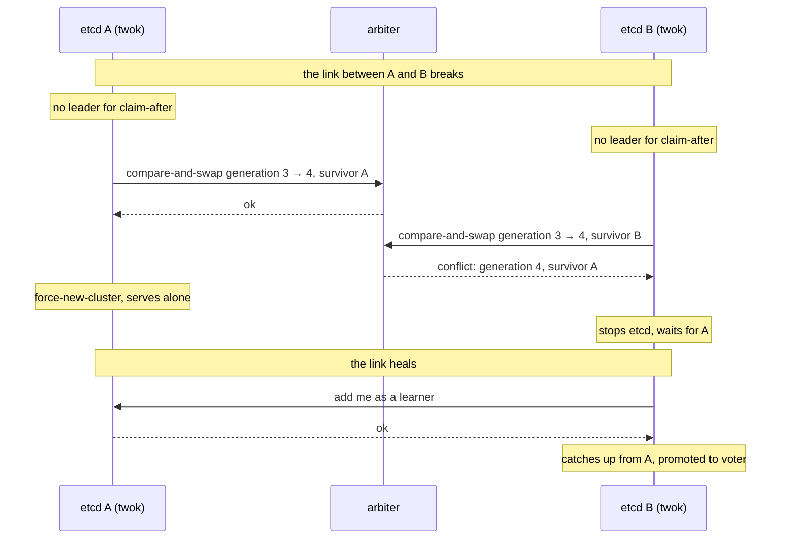

# twok

etcd on two members, with an external arbiter that breaks the tie.

> **Status: research.** twok is an experiment in running etcd across two sites without a third member. It is not released and not meant for production. The design, the safety argument and the failure model are in [docs/design.md](docs/design.md); what was measured on a test bench is in [docs/testing.md](docs/testing.md); the report of the first round is [docs/report.md](docs/report.md). Read them before running it anywhere that matters.

## The problem

Raft needs a majority. With two etcd members the majority is both of them, so the first failure stops the cluster: a dead node, a dead link, a dead site.
A third member in a third site fixes that, but it takes part in every write, so it needs to be as close as the other two. Not every pair of sites has such a third site.

## What twok does

twok is a small daemon next to each of the two etcd members, a sidecar on Kubernetes, a static Pod on Talos. While the cluster has a leader, twok does nothing.
When the cluster has had no leader for a while, each member tries to claim the right to go on alone in an **arbiter**: a small record in an external system that supports an atomic compare-and-swap.
Exactly one member can win. The winner stops its etcd, writes a cluster of one into its own log, and lets etcd start again as it always does; from then on it serves. The loser cannot commit anything, because Raft does not let a voter commit without the other, and when it meets the survivor again it is re-added as a learner and catches up from where it was.

The arbiter is not on the write path, holds a few hundred bytes, and only matters when the cluster has lost its leader. It can be:

- an S3 bucket;
- another etcd cluster;
- a Kubernetes API server;
- any HTTP service that implements conditional `PUT` with `If-Match`.

A new backend is a new package that implements one interface, see [docs/design.md](docs/design.md#arbiter-backends).



## What is guaranteed, and what is not

Guaranteed, for any sequence of link, node, site and arbiter failures, as long as the arbiter is a correct compare-and-swap register:

- no two clusters derived from the original accept writes at the same time;
- no write acknowledged to a client is lost by a takeover.

Not guaranteed:

- availability while the arbiter is unreachable at the moment of a failure: writes stop until it, or the peer, is back;
- availability after a double failure, when the survivor fails before the loser has rejoined;
- anything about clients that keep talking to the loser, or about workloads and storage on the losing node.

The full table, with what was measured and what is only assumed, is in [docs/design.md](docs/design.md#failure-model).

## How it runs

twok runs next to etcd and leaves etcd's image and command line alone. It needs the member's client API, the member's data directory, and a way to stop the etcd process; whoever runs etcd starts it again.

- **Kubernetes with etcd-operator:** a sidecar injected by a MutatingAdmissionPolicy, as threek does, see [deploy/](deploy/).
- **Kubernetes, hand-written:** the same sidecar in a StatefulSet, see [deploy/kubernetes/](deploy/kubernetes/).
- **Talos:** a static Pod on every control-plane node; designed from the Talos code, not tested yet.

## Development

```bash
make test   # unit and integration tests; set TEST_ETCD_BINARY to an etcd binary to run the tests against real clusters
make lint   # golangci-lint
make build  # bin/twok
```

## Related

- [threek](https://github.com/aenix-io/threek): keeps the Raft leader of a three-member etcd on a member every other member can reach.
- [Two-node OpenShift with fencing](https://www.redhat.com/en/blog/two-node-openshift-fencing-improves-reliability-edge): the same reconfiguration, with a BMC instead of an arbiter.

## License

Apache License 2.0, see [LICENSE](LICENSE).
