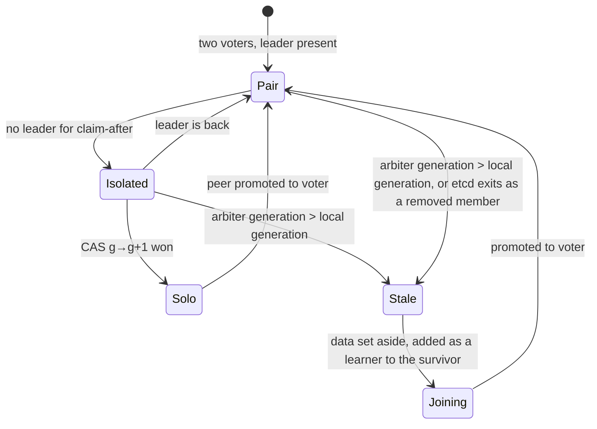

# twok design

Status: research. The design is written down before the code and is revised as the code and the tests teach us otherwise. Nothing here is released, and nothing is meant for production.

## Problem

Two sites, A and B, each with one etcd member, and no third site that can run a full etcd member close enough to the other two.
The question from the [original thread](https://www.reddit.com/r/kubernetes/comments/1vzokft/etcd_with_2_dcs_a_lightweight_arbiter/): can an external, lightweight arbiter break the tie, so that the loss of either site does not take etcd down, without a third member that takes part in every write?

Raft needs a majority of the voting members for every commit and every election.
With two voters, the majority is both of them, so the cluster stops at the first failure: a dead node, a dead link, or a dead site.
It stops safely, which is the point of Raft, but it stops.

twok keeps upstream etcd as it is and adds the one thing that is missing: a way to decide, safely, which of the two members may go on alone.

## What twok does

twok is a supervisor that runs the etcd process on each of the two members. It watches its own member and does nothing as long as the cluster has a leader. When the cluster has had no leader for a configured time, the supervisor tries to claim the right to continue alone in an **arbiter**: a record in an external system that supports an atomic compare-and-swap. Exactly one member can win the claim. The winner restarts its etcd as a cluster of one and serves. The loser cannot commit anything, by Raft itself, and when it meets the survivor again it discards its data and rejoins as a learner.

The arbiter is involved only when the cluster has lost its leader. It is not on the write path, it stores a few hundred bytes, and it needs no low latency. It can be an S3 bucket, another etcd cluster, a Kubernetes API server, or any HTTP service that implements the contract in [Arbiter backends](#arbiter-backends).

This is the mechanism Red Hat ships in two-node OpenShift with fencing, with one difference. Red Hat fences the other node through its BMC before the survivor reconfigures etcd, and that fencing both breaks the tie and stops the other node. twok breaks the tie with the arbiter and relies on Raft to stop the other node's etcd, which it does by construction: a voter without a quorum commits nothing. twok fences etcd, not the node. Workloads and storage on the losing node are out of scope; see [Failure model](#failure-model).

## The model

### Generations

The life of a twok cluster is a sequence of **generations**. Generation 0 is the bootstrap: two voters. Every time a member becomes the survivor the generation increases by one.

The arbiter holds one record per cluster:

```json
{
  "schemaVersion": 1,
  "clusterID": "e09a2cd26e182b15",
  "generation": 3,
  "survivor": "b",
  "survivorMemberID": "2a1a388f4c496b3e",
  "since": "2026-10-21T20:14:03Z",
  "twokVersion": "v0.1.0"
}
```

Every member keeps a small state file on the same volume as its etcd data directory:

```json
{"generation": 3, "role": "member"}
```

- `role: member` means the data directory is a legitimate copy of the cluster at this generation: the member was a voter at this generation, or became one by rejoining.
- `role: joining` means the data directory was discarded and the member is being rebuilt from the survivor.

A member with no state file is at generation 0.

### The rule

> A member may become the survivor of generation g+1 only if it is a voter with a legitimate copy of generation g, and it wins the compare-and-swap from g to g+1 in the arbiter.

The compare-and-swap is the whole tie-break. Two members that race for the same generation cannot both win. A member whose data belongs to an older generation than the arbiter's does not even try: its data is stale by definition, because a newer generation exists only when another member went on alone.

### Roles and transitions



**Pair.** etcd runs with two voters and has a leader. twok polls the local member's `Status` every `poll-interval` and remembers who the leader is. Nothing else happens; the arbiter is not contacted.

**Isolated.** The local member has reported no leader for `claim-after`. The leader of a two-voter cluster steps down as soon as it loses its follower (CheckQuorum), so both members see no leader within an election timeout, whatever the cause: a dead peer, a dead link, or a dead site. twok reads the arbiter:

- If the arbiter's generation is higher than the local one, this member is stale and goes to **Stale**.
- If the generations are equal, this member is a candidate. It waits `claim-delay`, plus `follower-extra-delay` if it was not the last leader it saw, then attempts the compare-and-swap from g to g+1 with itself as survivor. The delays give the last leader the first chance: its commit index is authoritative, the follower's may lag by a heartbeat.
- If the arbiter cannot be reached, nothing happens, and the member stays isolated. etcd stays up and refuses writes on its own.
- If a leader comes back at any point, the member returns to **Pair**.

**Solo.** The member won. It writes `{"generation": g+1, "role": "member"}` to its state file, stops etcd, marks every entry in its own log as committed (see [The follower's last entries](#the-followers-last-entries)), starts etcd once with `--force-new-cluster`, waits for it to lead a cluster of one, and restarts it without the flag. From then on it serves. twok does not renew anything in the arbiter: a cluster of one keeps its quorum until a second voter is added, and only twok adds one.

**Stale.** The member lost. Its etcd is stopped, if it had not already exited: a removed member that reaches the survivor's peer port is told it was removed (HTTP 410 on the peer stream) and exits, with exit code 0 and no marker on disk. twok does not parse that; on any etcd exit it reads the arbiter, and restarts etcd with a backoff while the arbiter cannot be reached. twok sets the data directory aside (the `member` directory is renamed, and only the latest copy is kept), writes `{"generation": <arbiter's>, "role": "joining"}`, and goes to **Joining**.

**Joining.** twok waits until the survivor's client API answers, asks it to add the local member as a learner, and starts etcd with `--initial-cluster-state=existing` and an initial cluster of the two members. When the learner has caught up, twok asks the survivor to promote it. When the local member reports that it is a voter, twok writes `{"generation": g, "role": "member"}` and is back in **Pair**.

The survivor's twok takes no part in the rejoin beyond answering the API calls: the joining member drives its own return. The survivor returns to **Pair** when its member list shows two voters again.

### Startup

twok starts etcd without consulting the arbiter when the state file says `member`:

- If the data directory holds two voters, etcd cannot commit without the peer. If the peer became the survivor in the meantime, this member finds out from the arbiter during the next isolation, or from the survivor itself, which rejects it as removed.
- If the data directory holds one voter, this member is the survivor of its generation, and no other member can have claimed a newer generation. A newer claim requires a voter at this generation, which means a member promoted into this cluster of one, and that promotion is in this member's log.

Blocking the start on the arbiter would cost availability in exactly the case where the arbiter is not needed. twok still reads the arbiter at start when it can, logs the result, and acts on it if it shows the member is stale.

When the state file says `joining`, twok resumes the join: it removes a half-added learner with the local peer URL if one is listed, and continues from **Stale**.

## Safety argument

The property to prove: at any time, at most one etcd cluster derived from the original one accepts writes, and every write acknowledged to a client before a failure is present on the survivor after it.

1. **At most one survivor per generation.** The arbiter's compare-and-swap from g to g+1 succeeds for at most one writer. Every backend provides this through a single primitive: a conditional write on a version token. A backend that cannot do that is not an arbiter; see [Arbiter backends](#arbiter-backends).

2. **A loser never commits.** Until a member runs `--force-new-cluster`, its membership has two voters, and Raft commits nothing without both. Linearizable reads go through the same quorum check and fail as well. Serializable reads are served from the local copy and may be stale, which is their documented contract. This holds whether or not the loser knows it lost, and whether or not it can reach the arbiter.

3. **A stale member never becomes a survivor.** The claim requires the member's generation to equal the arbiter's. A member at generation g cannot claim g+2. It can only rejoin g+1 as a learner, and it becomes a candidate for g+2 only after it is promoted, at which point its log contains everything committed at g+1 up to the promotion, and everything after the promotion needs its acknowledgement.

4. **A learner never becomes a survivor.** The claim requires `IsLearner == false` from the local member. A learner's log may lag arbitrarily, because the cluster of one commits without it.

5. **Two members never run as clusters of one at the same time.** By 1 and 3: a second survivor needs a newer generation, which needs a voter at the current one, which needs a promotion into the current survivor's cluster, after which the current survivor has two voters again and cannot commit alone.

6. **Acknowledged writes survive.** A write acknowledged at generation g was committed by the leader, so both voters hold it in their logs. The survivor is one of the two voters, so its log holds it. `--force-new-cluster` keeps every entry up to the member's own commit index; the paragraph below covers the entries after it.

### The follower's last entries

A follower acknowledges an entry to the leader as soon as it is in its log. The leader commits it, answers the client, and tells the follower about the new commit index in its next message to it. If the partition hits in between, the follower holds an acknowledged entry that it does not know is committed, and it never learns. etcd's `--force-new-cluster` discards entries after the member's commit index, so a follower that becomes the survivor would lose it. Two details make the window wider than a heartbeat: the leader's notification is one message, lost with the partition, and the commit index alone is written to the WAL without a sync, so even a notification that arrived may not be on disk when the follower is killed. The fix in etcd 3.5.22 and 3.6.1, which keeps entries up to the applied index, does not cover this case: a follower cannot apply what it does not know is committed. The sources are in the research notes under [docs/research/](research/).

twok closes this window. Before it runs `--force-new-cluster`, it rewrites the hard state in the member's WAL so that the commit index equals the last index of the log. This is safe in a two-voter cluster and only there:

- Every committed entry is in both logs, because a commit needs both acknowledgements.
- No entry in either log was ever contradicted by a committed entry at the same index, because contradicting it would have required that member's acknowledgement, and the acknowledgement overwrites the entry.
- So the survivor's log is a prefix-consistent superset of the committed log. Treating all of it as committed commits some proposals that had timed out for their clients. A timed-out request is allowed to take effect; that is the contract every etcd client already lives with.

The last leader is still preferred as the survivor through `follower-extra-delay`, so that in the common case no such entries exist at all.

This step is the one place where twok touches etcd's files. It uses etcd's own WAL package and nothing else, and it is covered by a test that produces exactly this situation and checks that the acknowledged write survives.

## Failure model

What the tests must show, with twok running on both members and the arbiter in a third place.

| Scenario | Survivor | Loser | Guaranteed by |
| --- | --- | --- | --- |
| Link A-B down, both reach the arbiter | the last leader, or the first to claim | stops committing at once, rejoins after the link heals | CAS, Raft |
| Link A-B down, only A reaches the arbiter | A | B stops committing | CAS, Raft |
| Link A-B down, arbiter unreachable from both | none: writes stop until the arbiter or the link is back | | Raft |
| Site A down | B | A rejoins when it returns | CAS, generations |
| Site A down, then B down before A returns | none: B's data is the only legitimate copy, A waits for it | | generations |
| Arbiter down, cluster healthy | nothing changes: writes continue | | design: the arbiter is off the write path |
| Old survivor returns after the other member claimed a newer generation | the newer generation | the old survivor rejoins as a learner | generations |
| Both members restart, same generation | the pair forms again | | etcd |
| Partition flaps | claims only after `claim-after` without a leader; a claim that already happened is final | | timers, generations |
| One-way link failure | the same as a full link failure: no commit without both directions | | Raft |

What is guaranteed:

- No two clusters derived from one accept writes at the same time, for any sequence of link, node, site and arbiter failures, as long as the arbiter is a correct compare-and-swap register and nobody edits the arbiter, the state files or the data directories by hand.
- No write acknowledged to a client is lost by a takeover.

What is not guaranteed:

- Availability when the arbiter is unreachable at the time of the failure. Writes stop until the arbiter, or the peer, is reachable again.
- Availability after a double failure: the survivor fails before the loser has rejoined. The loser's data is older than the survivor's, and twok refuses to serve it. An operator who accepts the loss can force it; see [Manual intervention](#manual-intervention).
- Anything about clients. A client that keeps talking to the loser gets errors until it reconnects to the survivor. Client routing is the same problem threek has and is solved the same way: list both members in the client, or route by site.
- Anything about workloads or storage on the losing node. twok stops etcd from committing; it does not stop the node.

What is measured, on a test bench, and reported in [docs/testing.md](testing.md):

- Time from a failure to the survivor accepting writes, with default settings.
- Time from a link healing to the pair being restored.
- That a write acknowledged by the leader and held by the follower survives a takeover by the follower.

What is assumed:

- The arbiter backend honours its conditional write exactly as documented. twok checks this once at startup on a probe key next to the record, and refuses the backend if the check fails.
- Clocks are not relied on for safety. Timers only decide when to try a claim; the claim itself is decided by the arbiter.
- The state file and the data directory live on the same volume and move together.

## Expected timeline with defaults

Link A-B breaks at T, A was the leader, both reach the arbiter:

| Time | Event |
| --- | --- |
| T + 1 s | A steps down (CheckQuorum, election timeout), B times out on the leader; both report no leader |
| T + 21 s | `claim-after` (20 s) passes on both; both read the arbiter and see their own generation |
| T + 24 s | A's `claim-delay` (3 s) passes, A wins the compare-and-swap |
| T + 29 s | B's extra delay passes, B's compare-and-swap fails, B goes to Stale |
| T + 30 s | A's etcd has been restarted twice and serves as a cluster of one |

The numbers are starting points. Red Hat waits minutes before fencing to ride out short outages; the right value depends on the links.

## etcd versions

twok talks to etcd through the client API and touches the data directory only with etcd's own WAL package, whose format is the same in 3.5 and 3.6. The tests run against the newest 3.5 and the newest 3.6.

Two etcd bugs matter for the takeover and the rejoin, and both are avoided or fixed in newer patch releases:

- Before 3.5.20 a learner's promotion was stored only in the v2 store, and the member becomes a learner again on an upgrade to 3.6. Run 3.5.20 or later.
- Before 3.5.25 `--force-new-cluster` does not remove a learner that is already in a snapshot, and the removal of the other member may not reach the backend when the applied index is ahead of the commit index. twok writes the commit index at the last entry before the restart, which puts it ahead of the applied index and avoids the second case; the first case does not occur in twok's flows, where a learner exists only while the survivor is already alone.

## Configuration

| Setting | Default | Meaning |
| --- | --- | --- |
| `name` | | the etcd member name, taken from the etcd arguments |
| `data-dir` | | the etcd data directory, taken from the etcd arguments |
| `arbiter` | | the arbiter URL, see [Arbiter backends](#arbiter-backends) |
| `poll-interval` | `1s` | how often the local member's status is read |
| `claim-after` | `20s` | how long the cluster must be without a leader before a claim is considered |
| `claim-delay` | `3s` | extra wait before the claim for the member that was the last leader |
| `follower-extra-delay` | `5s` | extra wait on top of `claim-delay` for a member that was not the last leader |
| `commit-tail` | `true` | mark the whole log as committed before `--force-new-cluster` |
| `metrics-listen` | empty | address for Prometheus metrics |

twok reads the etcd arguments it is given after `--`, takes the member name, the data directory, the client and peer URLs and the TLS files from them, and passes everything through to etcd. It changes only `--initial-cluster`, `--initial-cluster-state` and `--force-new-cluster`, and only during a takeover or a rejoin.

## Arbiter backends

The arbiter is one record with a version token and one operation besides reading it:

```go
// Arbiter is a compare-and-swap register for one cluster's record.
type Arbiter interface {
    // Read returns the record and its version, or ErrNotFound and the
    // version that creates it.
    Read(ctx context.Context) (Record, Version, error)
    // CompareAndSwap writes record if the current version is expected.
    // It returns ErrConflict when it is not. On any other error the
    // caller must assume the write may have happened.
    CompareAndSwap(ctx context.Context, expected Version, record Record) (Version, error)
}
```

A backend lives in its own package, registers its URL scheme, and touches nothing else. Adding a backend is adding a package.

| Scheme | Store | Version token | Conditional write |
| --- | --- | --- | --- |
| `s3://bucket/key` | S3-compatible object store | ETag | `PUT` with `If-Match`, `If-None-Match: *` to create |
| `etcd://host:2379/key` | another etcd cluster | mod revision | transaction on `ModRevision` |
| `kubernetes://namespace/name` | a ConfigMap in a Kubernetes API server | resourceVersion | update with the resourceVersion |
| `http://host/path` | any HTTP service | ETag | `PUT` with `If-Match`, `If-None-Match: *` to create, `412` on mismatch |
| `file:///path` | a local file, for tests | content hash | lock and rename |

Not every S3-compatible store implements conditional writes, and some ignore the headers instead of rejecting them. twok verifies the conditional write on a probe key at startup and refuses to run against a store that does not honour it. The probe is a write next to the record, under the same prefix with a `.probe` suffix.

The `http` contract is small enough for a Cloudflare Worker with a Durable Object, a few lines of any web framework, or `twok arbiter serve`, a reference implementation that keeps its records in a file. That server is a single point of failure for arbitration, not for writes, which is the trade-off the arbiter model makes everywhere.

## Manual intervention

`twok arbiter get` prints the record. `twok arbiter claim --survivor <name>` moves the generation forward by hand, for the double failure above: the operator declares a member the survivor, accepts that writes after the last common point are lost, and twok on that member does the takeover at the next poll. The command refuses to run without an explicit `--accept-data-loss`.

An administrator who runs `--force-new-cluster` by hand must also claim the generation, or the other member will not know whom to follow.

## Deployment

twok is one binary with the etcd binary next to it. The etcd process is a child of twok and is restarted by twok; etcd's image, version and arguments stay with whoever provides them.

- **Kubernetes:** a StatefulSet of two Pods, each running `twok run -- etcd ...` with an init container that copies the etcd binary from the upstream image. `deploy/kubernetes/` holds the manifests, with the arbiter URL in a ConfigMap and the credentials in a Secret.
- **etcd-operator:** not supported without changes to the operator. The operator builds the member Pods itself, with the etcd image as the only container and no way to add one or change the command. What the operator would need is listed in [docs/etcd-operator.md](etcd-operator.md).
- **Talos:** not supported. Talos runs etcd as a system service from its own image, outside Kubernetes, and twok cannot supervise it. A two-node Talos control plane with an arbiter needs the same mechanism inside Talos, which is a question for Talos.

## Security

- twok listens on nothing but its optional metrics endpoint. It connects to the two members' client URLs and to the arbiter.
- It authenticates to etcd with the member's own certificates, and to the arbiter with whatever the backend needs, read from files or the environment.
- It writes the state file, renames the data directory on a rejoin, and rewrites the WAL hard state on a takeover. Nothing else on disk.
- The arbiter record contains member names, IDs and timestamps. No data, no keys.

## Observability

Every transition is logged with its reason and the generation.

| Metric | Meaning |
| --- | --- |
| `twok_generation` | the local generation |
| `twok_role{role}` | 1 for the current role: pair, isolated, solo, stale, joining |
| `twok_leader_seen` | 1 when the last poll reported a leader |
| `twok_arbiter_reachable` | 1 when the last arbiter read succeeded |
| `twok_claims_total{result}` | claims attempted, by result: won, lost, error |
| `twok_rejoins_total{result}` | rejoins, by result |
| `twok_last_poll_timestamp_seconds` | Unix time of the last successful poll |

## Testing

- **Unit tests** for the state machine, a pure function of observations and timers: every row of the failure model table, flapping, learners, unknown arbiter state, a stale state file.
- **Unit tests** for every arbiter backend against a fake of its store, with the conflict paths exercised.
- **Integration tests** with real etcd processes and mTLS. Two members talk to each other through TCP proxies that the test can cut, one direction at a time. The arbiter is in memory. The tests assert the failure model table, measure the timeline, and produce the follower's-last-entries situation on purpose.
- **End-to-end tests** in containers with `iptables` blackholes, as in threek, in CI.
- **Kubernetes tests** against a real cluster, with partitions made by network policies, documented with their commands and results in [docs/testing.md](testing.md).

## Rejected alternatives

| Alternative | Why not |
| --- | --- |
| A witness in Raft: a third voter that stores no log, only terms and votes | needs a Raft and etcd fork, and the witness still has to persist a vote per election; the arbiter model gets the same tie-break with upstream etcd |
| A stateless proxy over two independent etcd clusters | the proxy has to resolve the same tie, and it is on the write path of every request |
| A full third member in a third site | the question twok asks is how to avoid exactly that, because of latency and cost |
| Node fencing through a BMC, as in Red Hat's two-node OpenShift | the right tool when the node's workloads and storage must be stopped too; for etcd alone, Raft already stops the loser, and most of our targets have no BMC the cluster may use |
| A lease with a TTL instead of generations | a lease expires while the holder still serves, and the loser could take it over with stale data; the generation is monotonic and the loser's data says which generation it belongs to |
| Re-adding the loser by copying a snapshot | the learner path is what etcd supports and what the operator will do; a snapshot copy would need twok to run etcdutl on both sides |
| twok as a sidecar that only observes, as threek | a takeover needs a restart of etcd with different flags, which only the process's parent can do |
| Keeping `--force-new-cluster` in the arguments after the takeover | an etcd restart while a learner is joining would remove the learner again |

## Open questions

1. Whether `claim-after` should scale with the election timeout, or stay a wall-clock setting as Red Hat's fencing delay is.
2. Whether the survivor should wait for a quiet period before accepting a learner, to spread the catch-up load.
3. What the operator needs to run two-member clusters natively; see [docs/etcd-operator.md](etcd-operator.md).
